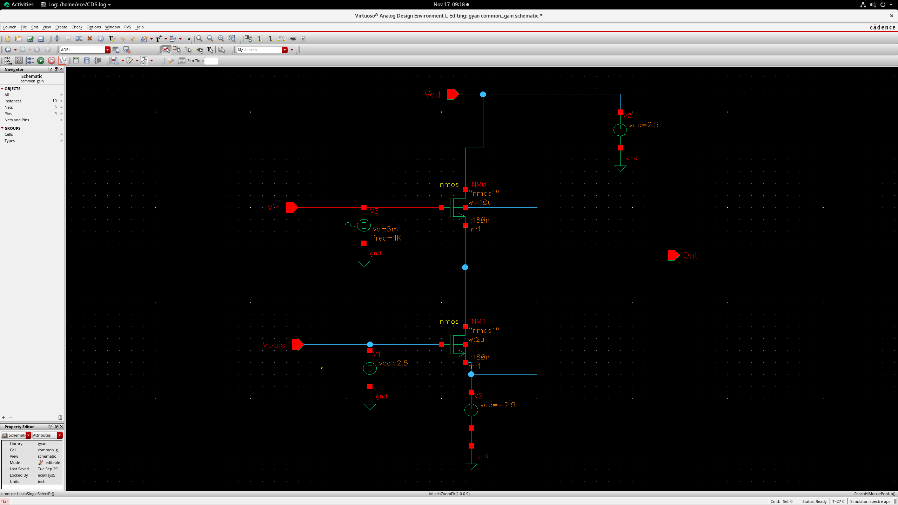
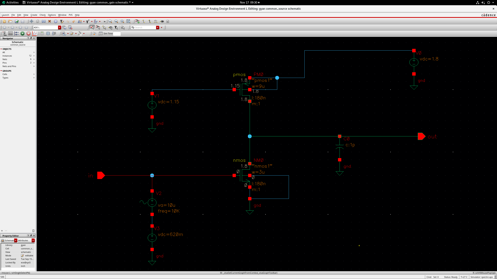
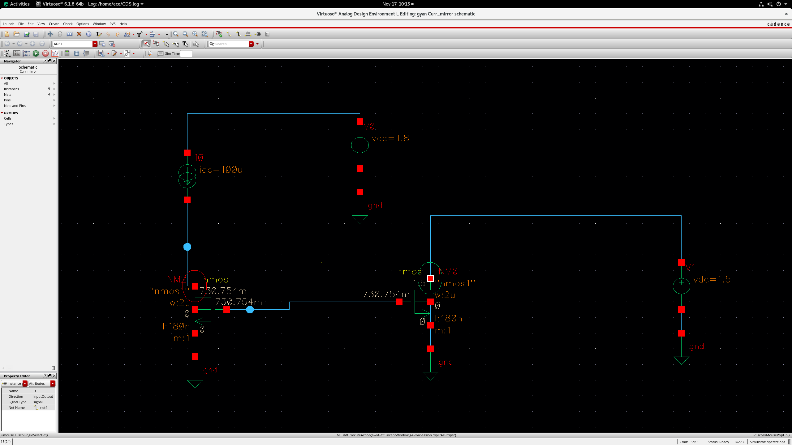
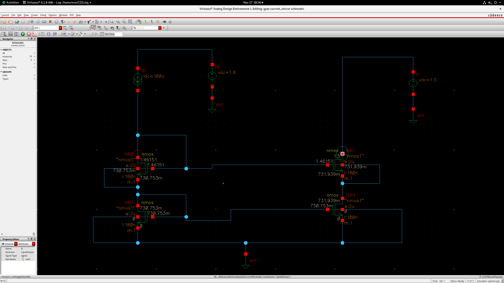
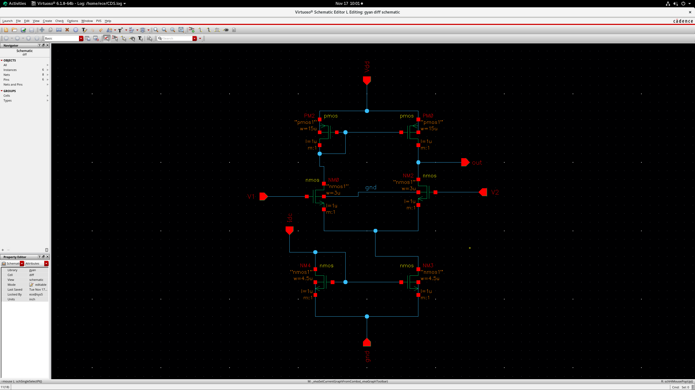

# Analog IC Design Experiments — Cadence Virtuoso (gpdk180)

Five basic analog circuits designed and simulated in Cadence Virtuoso with the 180 nm gpdk180 process. Each experiment has a description, circuit theory, all schematic and simulation settings, results and the original screenshots.

## Experiments
| # | Experiment | Library cell | Key result |
|---|---|---|---|
| 1 | [Common Drain (Source Follower)](experiments/01_common_drain) | `common_gain` | gain about 0.64 V/V, no phase inversion |
| 2 | [Common Source (PMOS load)](experiments/02_common_source) | `common_source` | gain about 24 V/V, 180° phase shift |
| 3 | [Basic Current Mirror](experiments/03_current_mirror) | `Curr_mirror` | 100 µA copied to about 115.8 µA at 1.5 V |
| 4 | [Cascode (Two-Stage) Current Mirror](experiments/04_cascode_current_mirror) | `current_mirror` | 100 µA copied to about 100.03 µA at 1.5 V |
| 5 | [Differential Amplifier](experiments/05_diff_amplifier) | `diff`, `diff_test` | gain about 102 V/V (40 dB) |

## Schematics

### 1. Common Drain
[](experiments/01_common_drain)

### 2. Common Source
[](experiments/02_common_source)

### 3. Basic Current Mirror
[](experiments/03_current_mirror)

### 4. Cascode Current Mirror
[](experiments/04_cascode_current_mirror)

### 5. Differential Amplifier
[](experiments/05_diff_amplifier)

## Common Setup
- Cadence Virtuoso IC6.1.8-64b, ADE L, Spectre APS
- gpdk180 process (`nmos1`, `pmos1`), temperature 27 °C
- Analyses used: transient, AC, DC sweep

## Repository Structure
```
.
├── README.md
├── .gitignore
├── cadence_lib/gyan/            # Virtuoso library (OpenAccess database)
│   ├── common_gain/             # Exp 1
│   ├── common_source/           # Exp 2
│   ├── Curr_mirror/             # Exp 3
│   ├── current_mirror/          # Exp 4
│   ├── diff/                    # Exp 5 core (schematic + symbol)
│   └── diff_test/               # Exp 5 testbench
└── experiments/
    ├── 01_common_drain/         # README.md + images/
    ├── 02_common_source/
    ├── 03_current_mirror/
    ├── 04_cascode_current_mirror/
    └── 05_diff_amplifier/
```

## Opening the Designs in Virtuoso
1. Clone the repository.
2. Add this line to your `cds.lib`:
   ```
   DEFINE gyan /path/to/Analog-ic-Design/cadence_lib/gyan
   ```
3. Open Library Manager, select library `gyan`, then the cell and its `schematic` view.
4. The gpdk180 PDK and `analogLib` must be available.

The simulation setups are documented in each experiment README and shown in the screenshots. The ADE state is not stored in this library.

## Author
Gyan, B.Tech VLSI Design and Technology, NMIT Bengaluru
