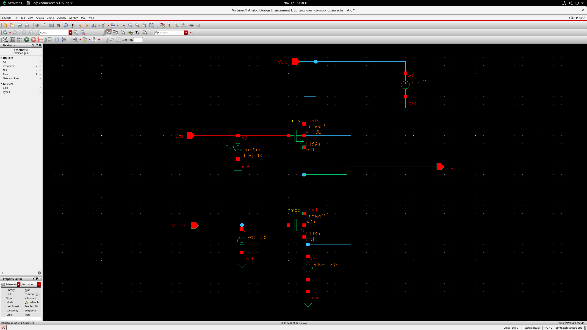
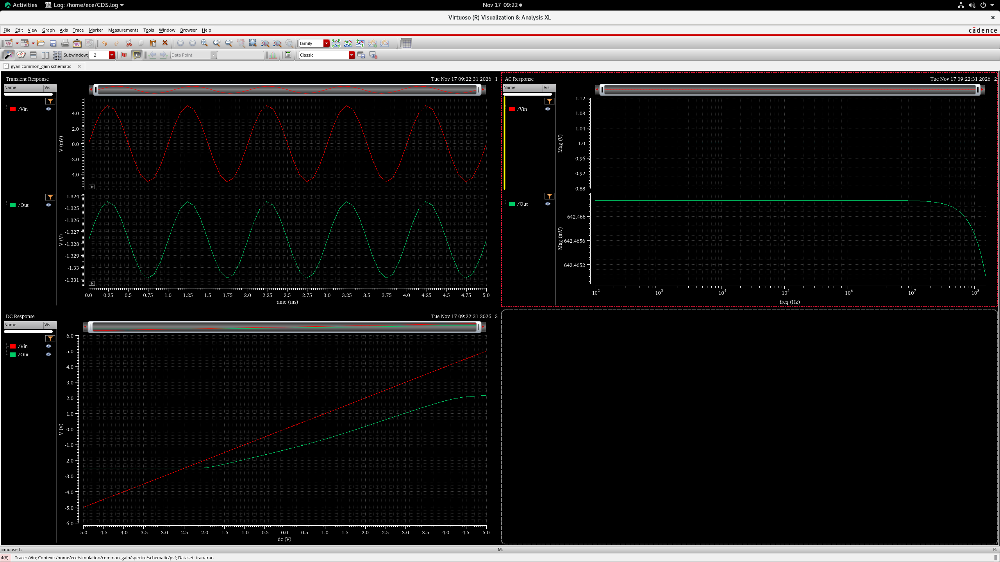
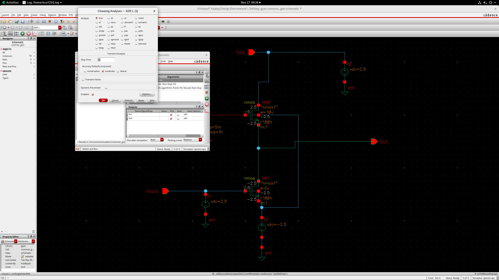
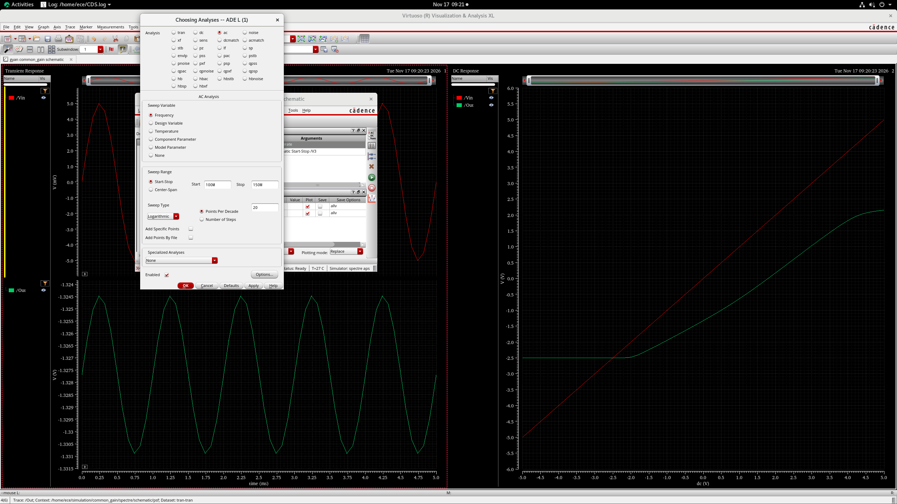
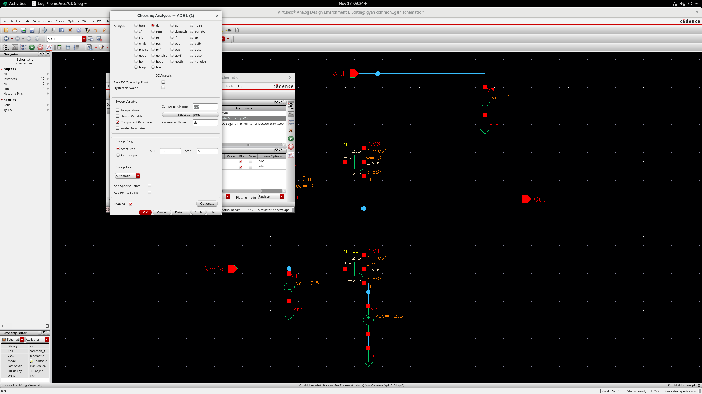

# Experiment 1 — Common Drain (Source Follower)

**Library cell:** `gyan / common_gain / schematic` (the cell named *common_gain* is the common-drain circuit)

## Aim
Study the common-drain (source follower) stage: voltage gain below unity, no phase inversion, DC level shift, and bandwidth.

## Description
NM0 is the amplifying device. The input is applied to its gate and the output is taken at its source. NM1 is a transistor current source (active load) biased by a DC voltage on its gate. The source follower's output follows the input with a gain slightly below 1 because of the body effect and finite output resistance.

## Circuit Theory
**Working principle**
- The input is applied at the gate of NM0 and the output is taken from its source. The drain is tied to the supply, so it is at small-signal ground.
- NM1 acts as a constant current source for NM0. A fixed bias current means a nearly fixed VGS, so the source voltage follows the gate voltage: Vout ≈ Vin − VGS.
- There is no phase inversion between input and output.
- In this schematic the bulk of NM0 is not tied to its source, so the body effect (gmb) reduces the gain further.

**Key equations**
- Voltage gain: Av = gm·R / (1 + (gm + gmb)·R), where R = ro0 ∥ ro1. This is always below 1.
- Output resistance: Rout ≈ 1 / (gm + gmb)
- Input resistance: very high (gate of a MOSFET)

**Typical use:** a voltage buffer or level shifter, because of its high input resistance and low output resistance.

## Schematic settings
| Item | Value |
|---|---|
| NM0 (driver) | `nmos1`, W = 10 µm, L = 180 nm, m = 1 |
| NM1 (current-source load) | `nmos1`, W = 2 µm, L = 180 nm, m = 1 |
| V0 (Vdd) | 2.5 V DC |
| V2 (Vss, NM1 source) | −2.5 V DC |
| V1 (Vbias, NM1 gate) | 2.5 V DC |
| V3 (input) | vsin, amplitude 5 mV, 1 kHz (DC value swept in the DC analysis, AC magnitude 1 V) |
| Pins | `Vin`, `Vbais`, `Vdd`, `Out` |

## Simulation settings (ADE L)
| Analysis | Setting |
|---|---|
| Transient | Stop time 5 ms, accuracy *moderate* |
| AC | Sweep frequency 100 Hz to 150 MHz, logarithmic, 20 points per decade |
| DC | Sweep component parameter `dc` of `/V3`, −5 V to 5 V, automatic step |
| Outputs | `Vin`, `Out` |

## Environment
- Tool: Cadence Virtuoso IC6.1.8-64b, ADE L
- Simulator: Spectre APS
- Temperature: 27 °C
- Process: gpdk180 (180 nm), devices `nmos1` / `pmos1`, L = 180 nm unless stated, m = 1
- Library: `gyan`

## Results (read from the plots)
| Quantity | Observation |
|---|---|
| Output DC level (transient) | about −1.33 V |
| Output swing for 10 mV p-p input | about 6.5 mV p-p, in phase with input |
| Mid-band AC gain | about 0.642 V/V (642.47 mV output for 1 V input) |
| AC response | flat from 100 Hz, roll-off begins around 10⁷–10⁸ Hz |
| DC transfer | Out follows Vin with a level shift; Out clamps near −2.5 V for low Vin and flattens near +2 V for high Vin |

## Figures
| | |
|---|---|
| Schematic |  |
| Transient, AC and DC results |  |
| Transient setup |  |
| AC setup |  |
| DC setup |  |

## Conclusion
The stage gives a gain below 1 (about 0.64), no phase inversion and a wide bandwidth, which is why it is used as a buffer.
