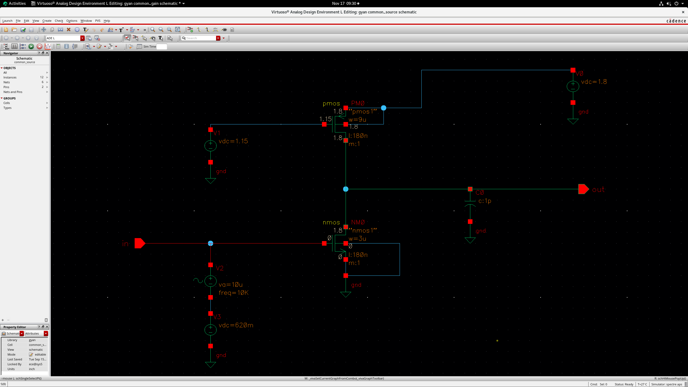
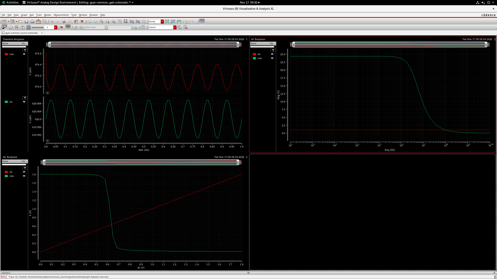
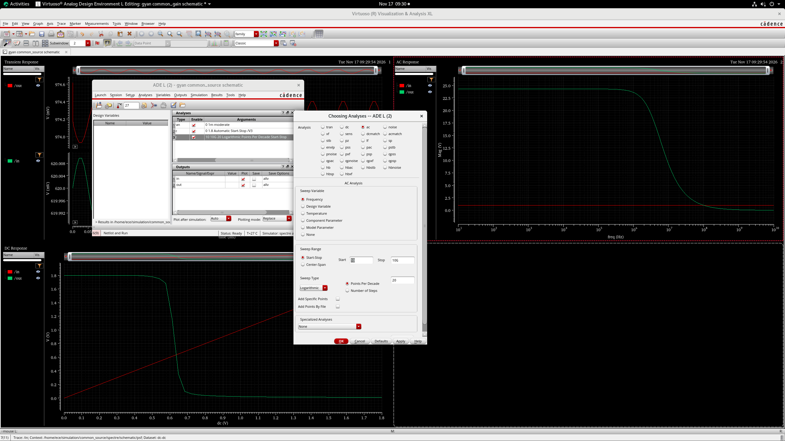
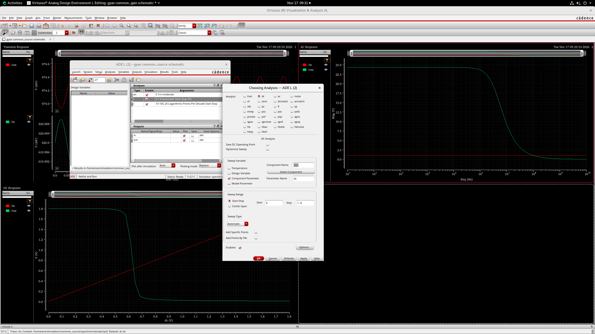

# Experiment 2 — Common Source Amplifier (PMOS Active Load)

**Library cell:** `gyan / common_source / schematic`

## Aim
Study a common-source amplifier with a PMOS active load: voltage gain, phase inversion, DC transfer characteristic and bandwidth.

## Description
NM0 is the amplifying device with the input on its gate and the output at its drain. PM0 acts as a current-source load, with its gate held at a fixed DC bias. A 1 pF capacitor at the output models the load capacitance and sets the bandwidth.

## Circuit Theory
**Working principle**
- The input is applied at the gate of NM0 and the output is taken from its drain.
- A small change in input voltage changes the drain current of NM0 by gm·vin. This current flows into the output resistance, which produces an amplified and inverted output.
- PM0 has a fixed gate bias (1.15 V), so it acts as a current source load. This gives a much higher load resistance than a resistor in the same area, and therefore higher gain.
- The input DC bias (620 mV) places NM0 in the high-gain region of the DC transfer curve, where both transistors are in saturation.
- The 1 pF capacitor at the output creates the dominant pole.

**Key equations**
- Voltage gain: Av = −gm,n · (ro,n ∥ ro,p)
- Output resistance: Rout = ro,n ∥ ro,p
- Dominant pole: f(−3 dB) ≈ 1 / (2π · Rout · CL)

**Typical use:** the basic gain stage of analog circuits.

## Schematic settings
| Item | Value |
|---|---|
| NM0 (driver) | `nmos1`, W = 3 µm, L = 180 nm, m = 1 |
| PM0 (active load) | `pmos1`, W = 9 µm, L = 180 nm, m = 1 |
| V0 (Vdd) | 1.8 V DC |
| V1 (PM0 gate bias) | 1.15 V DC |
| V3 (input DC bias, series with V2) | 620 mV DC |
| V2 (input signal) | vsin, amplitude 10 µV, 10 kHz |
| C0 (load) | 1 pF at `out` |
| Pins | `in`, `out` |

## Simulation settings (ADE L)
| Analysis | Setting |
|---|---|
| Transient | Stop time 1 ms, accuracy *moderate* |
| AC | Sweep frequency 10 Hz to 10 GHz, logarithmic, 20 points per decade |
| DC | Sweep component parameter `dc` of `/V3`, 0 V to 1.8 V, automatic step |
| Outputs | `in`, `out` |

## Environment
- Tool: Cadence Virtuoso IC6.1.8-64b, ADE L
- Simulator: Spectre APS
- Temperature: 27 °C
- Process: gpdk180 (180 nm), devices `nmos1` / `pmos1`, L = 180 nm unless stated, m = 1
- Library: `gyan`

## Results (read from the plots)
| Quantity | Observation |
|---|---|
| Output DC level (transient) | about 974 mV |
| Input DC level | about 620 mV |
| Mid-band AC gain | about 24 V/V (about 27.7 dB) |
| AC response | flat to about 1 MHz, then rolls off (single pole from the 1 pF load) |
| DC transfer | Out stays near 1.8 V for Vin below about 0.55 V, drops sharply between about 0.55 V and 0.7 V, then sits near 0 V |

The high-gain region of the DC transfer curve is around Vin ≈ 0.6 V, which is why the input bias is set to 620 mV.

## Figures
| | |
|---|---|
| Schematic |  |
| Transient, AC and DC results |  |
| Transient setup |  |
| AC setup |  |
| DC setup |  |

## Conclusion
The common-source stage gives high voltage gain (about 24 V/V) with 180° phase inversion, limited in bandwidth by the output load capacitance.
