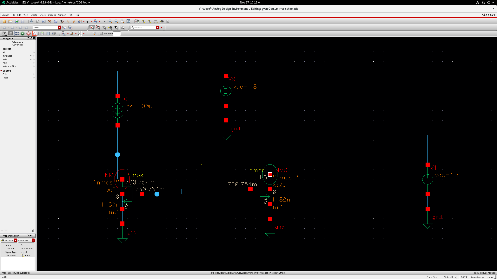
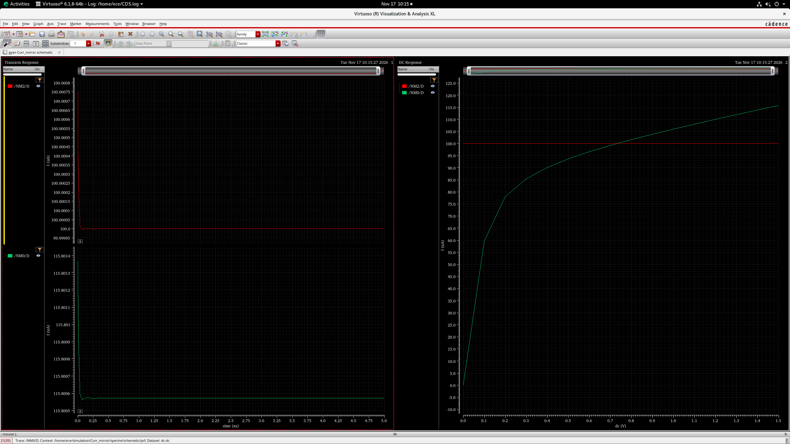
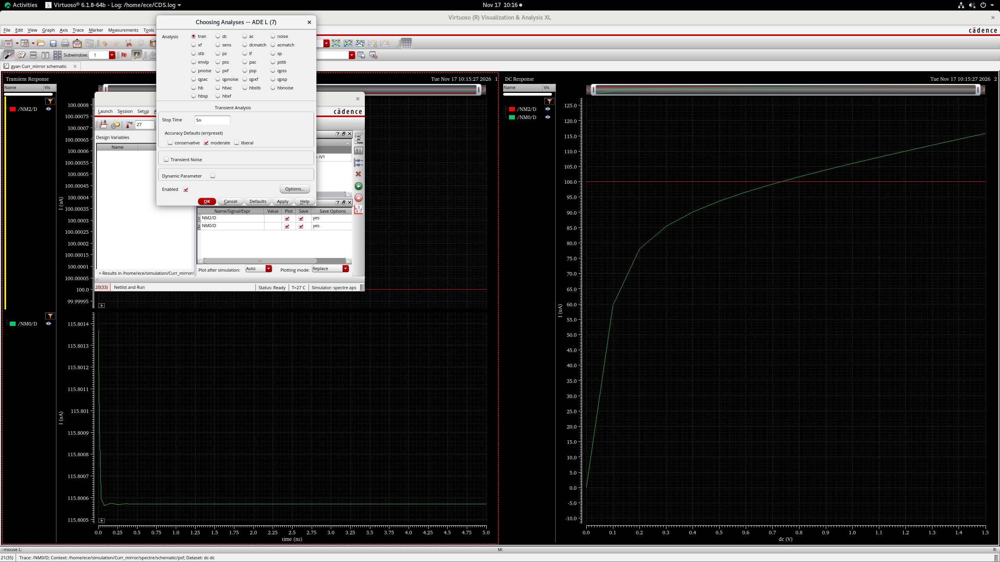
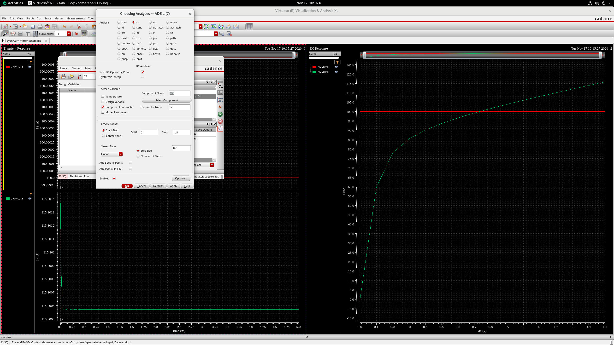

# Experiment 3 — Basic NMOS Current Mirror

**Library cell:** `gyan / Curr_mirror / schematic`

## Aim
Build a simple two-transistor current mirror and check how closely the output current copies the reference current, including the effect of output voltage (channel-length modulation).

## Description
NM2 is diode-connected and carries the 100 µA reference current. Its gate-source voltage is applied to NM0, which mirrors the current into the output branch. V1 acts as the output-branch supply, so sweeping V1 shows the output resistance of the mirror.

## Circuit Theory
**Working principle**
- NM2 is diode-connected (gate tied to drain), so it carries the reference current and sets the gate voltage VGS.
- The same VGS is applied to NM0. If both transistors are identical and in saturation, NM0 carries the same current as NM2 (a 1:1 mirror, since W/L is equal).
- In practice the output current changes with the output voltage because of channel-length modulation, which is the reason Iout is not exactly 100 µA at V1 = 1.5 V.

**Key equations**
- Mirror ratio: Iout = Iref · (W/L)out / (W/L)ref
- With channel-length modulation: Iout = Iref · (1 + λ·VDS,out) / (1 + λ·VDS,ref)
- Output resistance: Rout ≈ ro of the output transistor
- Minimum output voltage (compliance): VDS,sat = VGS − VTH

**Typical use:** DC biasing and current sources in analog ICs.

## Schematic settings
| Item | Value |
|---|---|
| NM2 (reference, diode-connected) | `nmos1`, W = 2 µm, L = 180 nm, m = 1 |
| NM0 (output) | `nmos1`, W = 2 µm, L = 180 nm, m = 1 |
| I0 (reference) | 100 µA DC, from Vdd |
| V0 (Vdd) | 1.8 V DC |
| V1 (output branch supply) | 1.5 V DC |
| Gate voltage (DC operating point) | 730.754 mV |

## Simulation settings (ADE L)
| Analysis | Setting |
|---|---|
| Transient | Stop time 5 ns, accuracy *moderate* |
| DC | Sweep component parameter `dc` of `/V1`, 0 V to 1.5 V, linear, step 0.1 V, Save DC operating point on |
| Outputs | `NM2/D`, `NM0/D` (plot and save) |

## Environment
- Tool: Cadence Virtuoso IC6.1.8-64b, ADE L
- Simulator: Spectre APS
- Temperature: 27 °C
- Process: gpdk180 (180 nm), devices `nmos1` / `pmos1`, L = 180 nm unless stated, m = 1
- Library: `gyan`

## Results (read from the plots)
| Quantity | Observation |
|---|---|
| Reference current `NM2/D` | 100 µA |
| Output current `NM0/D` at V1 = 1.5 V | about 115.8 µA (about 15.8 % above reference) |
| DC sweep | Iout rises steeply up to about 0.3 V, then keeps rising slowly; it crosses 100 µA near V1 ≈ 0.73 V (where both drains are at the same voltage) |

The slope of Iout against V1 in saturation shows the finite output resistance of the simple mirror.

## Figures
| | |
|---|---|
| Schematic |  |
| Transient and DC results |  |
| Transient setup |  |
| DC setup |  |

## Conclusion
The simple mirror copies the reference exactly only when both drain voltages match. At a higher output voltage the current error is large, which motivates the cascode mirror in Experiment 4.
