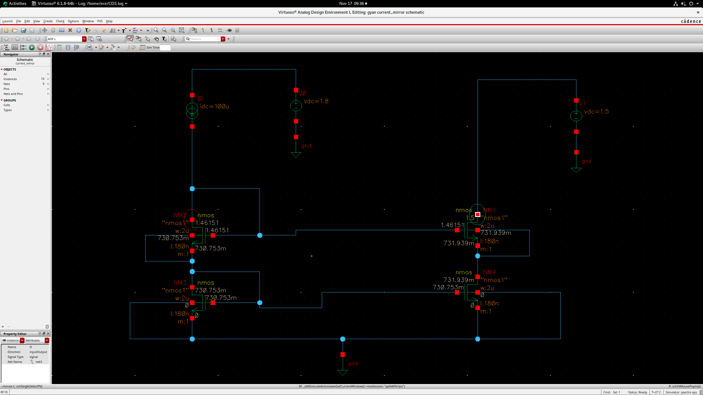
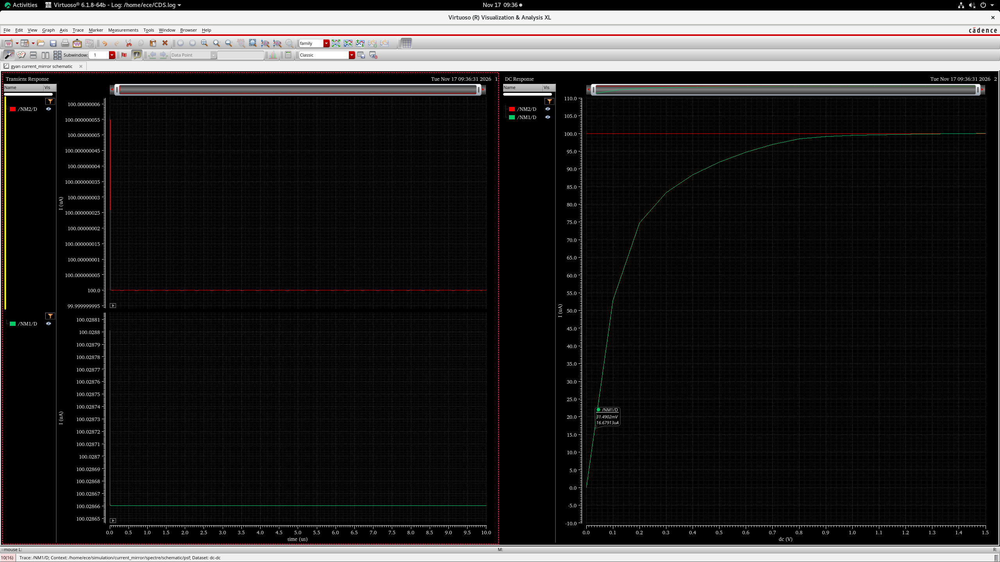
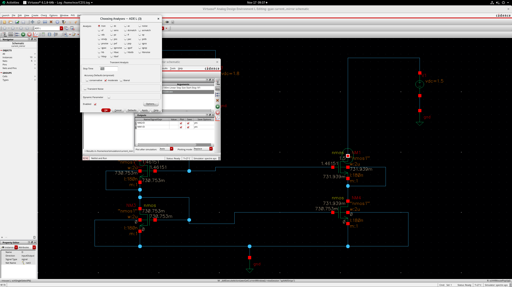
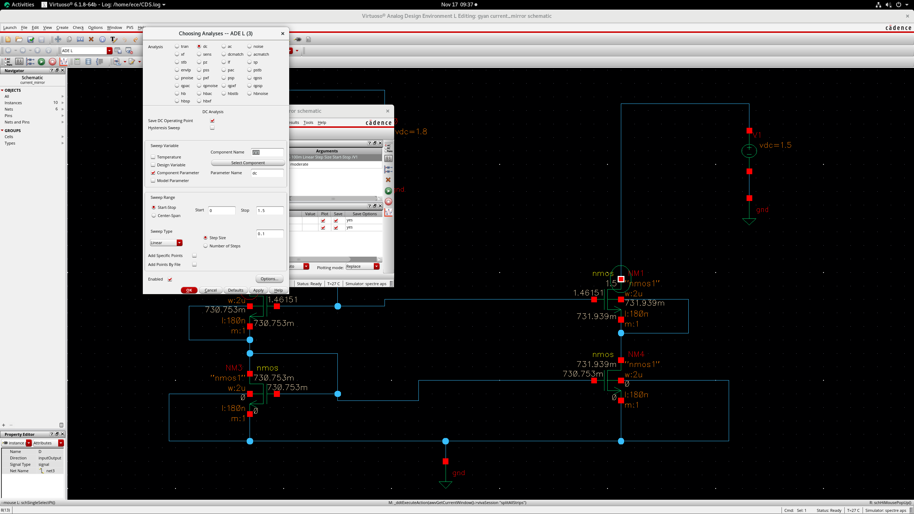

# Experiment 4 — Two-Stage (Cascode) Current Mirror

**Library cell:** `gyan / current_mirror / schematic`

## Aim
Improve the accuracy and output resistance of the current mirror by stacking two transistors in each branch (cascode mirror), and compare with Experiment 3.

## Description
The reference branch has two stacked diode-connected NMOS devices (NM2 on top, NM3 below). The output branch has NM1 (top) and NM4 (below), whose gates connect to the corresponding reference-branch nodes. The cascode device NM1 shields the mirror device NM4 from output-voltage changes, so Iout stays very close to Iref.

## Circuit Theory
**Working principle**
- This is a cascode current mirror. Each branch has two stacked transistors, and both devices in the reference branch are diode-connected.
- The lower devices (NM3, NM4) form the basic mirror. The upper devices (NM2, NM1) are cascode devices.
- The cascode device holds the drain of the lower mirror device nearly constant while the output voltage changes. This reduces channel-length modulation, so Iout stays very close to Iref.
- The cost is a higher minimum output voltage, because two transistors must stay in saturation.

**Key equations**
- Output resistance: Rout ≈ gm · ro² (much higher than the simple mirror's ro)
- Minimum output voltage (compliance): Vout,min ≈ VGS + VDS,sat (about two overdrive voltages plus one threshold)

**Typical use:** precision current sources and high-gain amplifier loads.

## Schematic settings
| Item | Value |
|---|---|
| NM2, NM3 (reference branch) | `nmos1`, W = 2 µm, L = 180 nm, m = 1 each |
| NM1, NM4 (output branch) | `nmos1`, W = 2 µm, L = 180 nm, m = 1 each |
| I0 (reference) | 100 µA DC, from Vdd |
| V0 (Vdd) | 1.8 V DC |
| V1 (output branch supply) | 1.5 V DC |
| DC operating point | upper gate 1.46151 V, lower gate 730.753 mV |

## Simulation settings (ADE L)
| Analysis | Setting |
|---|---|
| Transient | Stop time 10 µs, accuracy *moderate* |
| DC | Sweep component parameter `dc` of `/V1`, 0 V to 1.5 V, linear, step 100 mV, Save DC operating point on |
| Outputs | `NM2/D`, `NM1/D` (plot and save) |

## Environment
- Tool: Cadence Virtuoso IC6.1.8-64b, ADE L
- Simulator: Spectre APS
- Temperature: 27 °C
- Process: gpdk180 (180 nm), devices `nmos1` / `pmos1`, L = 180 nm unless stated, m = 1
- Library: `gyan`

## Results (read from the plots)
| Quantity | Observation |
|---|---|
| Reference current `NM2/D` | 100 µA |
| Output current `NM1/D` at V1 = 1.5 V | about 100.029 µA (about 0.03 % error) |
| DC sweep | Iout rises up to about 0.8 V and is flat at about 100 µA for the rest of the sweep |

## Comparison with Experiment 3
| | Simple mirror | Cascode mirror |
|---|---|---|
| Iout at V1 = 1.5 V | about 115.8 µA | about 100.03 µA |
| Error vs 100 µA | about 15.8 % | about 0.03 % |
| Flat region of Iout | none, keeps rising | from about 0.8 V upward |

## Figures
| | |
|---|---|
| Schematic |  |
| Transient and DC results |  |
| Transient setup |  |
| DC setup |  |

## Conclusion
The cascode mirror gives a much higher output resistance and a far more accurate copy of the reference current. The price is a higher minimum output voltage (about 0.8 V here).
