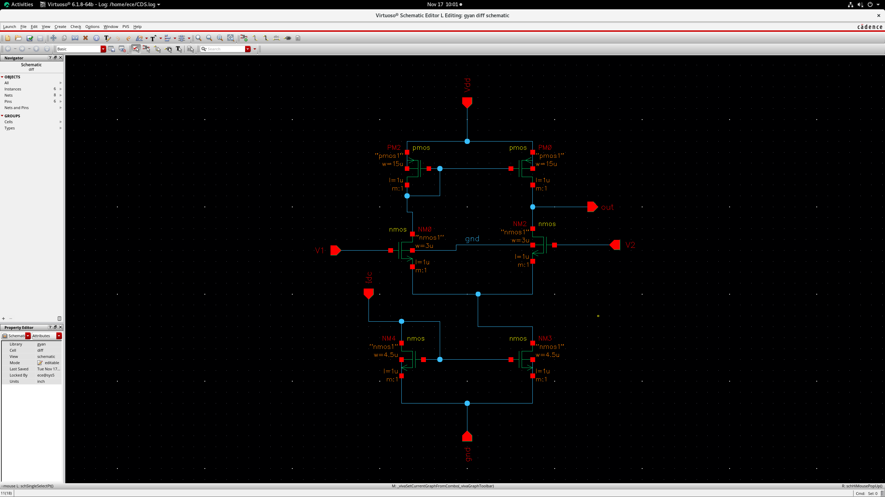
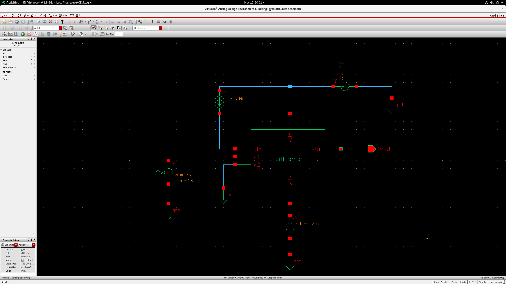
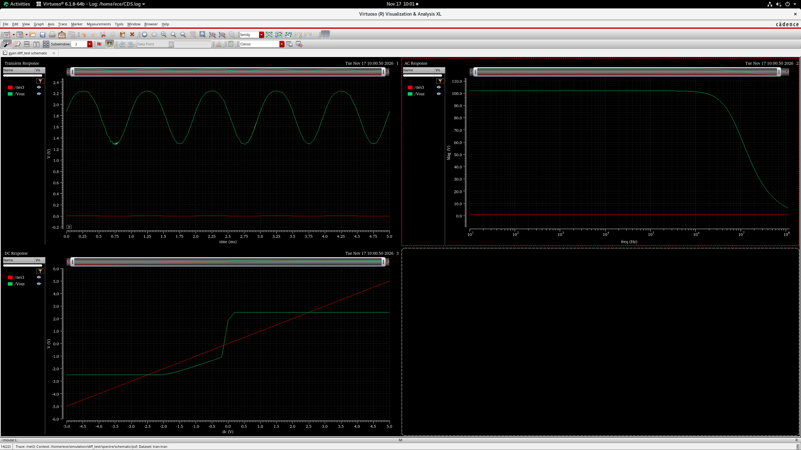
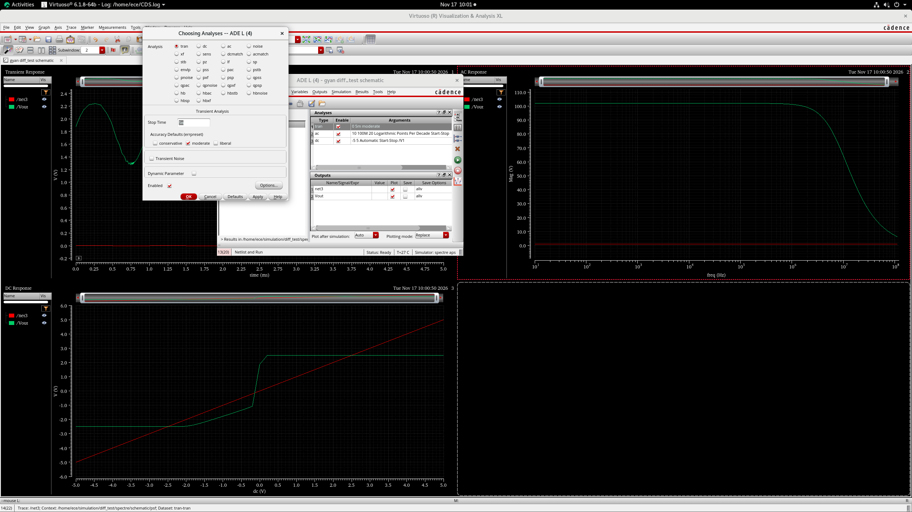
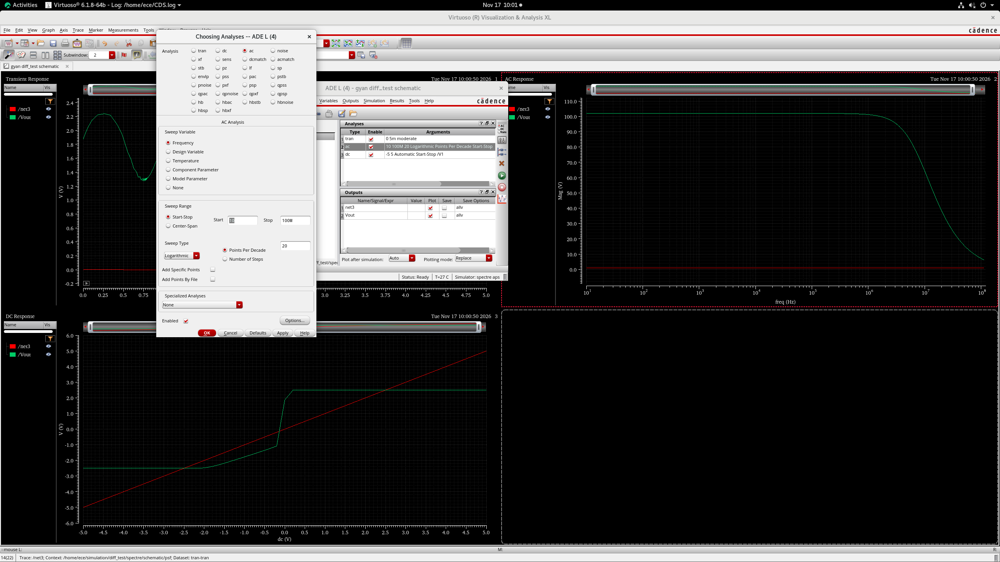
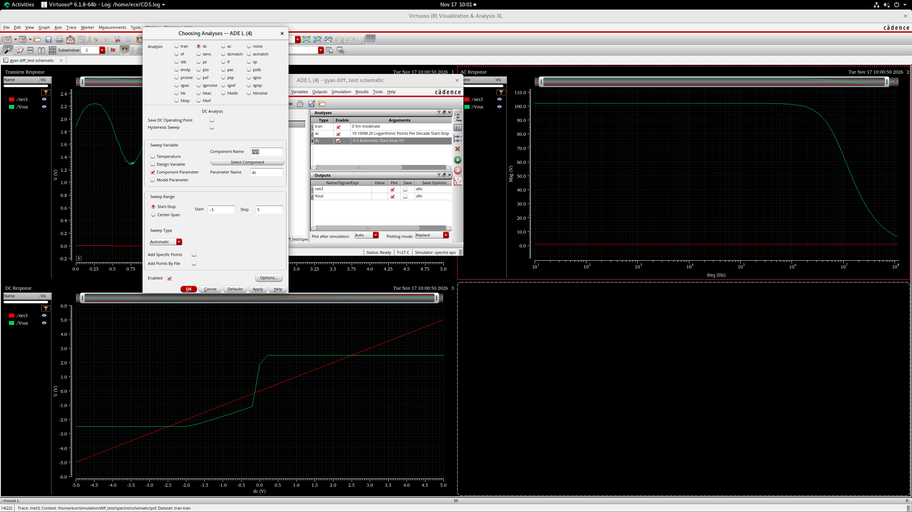

# Experiment 5 — Differential Amplifier (NMOS Pair, Current-Mirror Load)

**Library cells:** `gyan / diff / schematic` (amplifier core, with symbol `diff`) and `gyan / diff_test / schematic` (testbench)

## Aim
Study a single-ended-output differential amplifier: gain, bandwidth and DC transfer characteristic.

## Description
NM0 and NM2 form the differential input pair. PM2 (diode-connected) and PM0 form a PMOS current-mirror load, which converts the differential current into a single-ended output at `out`. The tail current comes from an NMOS current mirror (NM4 diode-connected, NM3), fed by an external current source at pin `Idc`.

## Circuit Theory
**Working principle**
- NM0 and NM2 form the input pair. The tail current source (NM3 mirrored from NM4) sets their total bias current, so the pair splits the tail current according to the difference between V1 and V2.
- PM2 and PM0 form a current-mirror load. PM2 is diode-connected and mirrors the drain current of one side into the other side. The output at `out` then carries the sum of both half-signals, which gives the full differential gain at a single output.
- The tail mirror (NM4, NM3) has equal W/L, so the tail current equals the 30 µA bias current at `Idc`, and each side carries about 15 µA at balance.
- In the testbench the signal is applied to V1 only and V2 is grounded. This is single-ended drive of a differential input.
- With a ±2.5 V supply, the output clips at about ±2.5 V for large inputs.

**Key equations**
- Differential gain: Ad = gm,n · (ro,n ∥ ro,p)
- Differential input: Vid = V1 − V2
- Tail current: ISS = Idc · (W/L)NM3 / (W/L)NM4, which equals Idc here
- Common-mode rejection is high because of the high output resistance of the tail current source.

**Typical use:** the input stage of op-amps and comparators.

## Schematic settings: `diff` (core)
| Item | Value |
|---|---|
| NM0, NM2 (input pair) | `nmos1`, W = 3 µm, L = 1 µm, m = 1 |
| PM2, PM0 (mirror load) | `pmos1`, W = 15 µm, L = 1 µm, m = 1 |
| NM4, NM3 (tail current mirror) | `nmos1`, W = 4.5 µm, L = 1 µm, m = 1 |
| Pins | `V1`, `V2`, `Idc`, `out`, `Vdd`, `gnd` |

## Testbench settings: `diff_test`
| Item | Value |
|---|---|
| V0 (Vdd) | +2.5 V DC |
| V2 (Vss, on `gnd` pin) | −2.5 V DC |
| I1 (bias current into `Idc`) | 30 µA DC |
| V1 input | vsin, amplitude 5 mV, 1 kHz |
| V2 input pin | grounded (single-ended drive) |
| Output | `Vout`; input node probed as `net3` |

## Simulation settings (ADE L)
| Analysis | Setting |
|---|---|
| Transient | Stop time 5 ms, accuracy *moderate* |
| AC | Sweep frequency 10 Hz to 100 MHz, logarithmic, 20 points per decade |
| DC | Sweep component parameter `dc` of `/V1`, −5 V to 5 V, automatic step |
| Outputs | `net3`, `Vout` |

## Environment
- Tool: Cadence Virtuoso IC6.1.8-64b, ADE L
- Simulator: Spectre APS
- Temperature: 27 °C
- Process: gpdk180 (180 nm), devices `nmos1` / `pmos1`, L = 180 nm unless stated, m = 1
- Library: `gyan`

Note: this experiment uses L = 1 µm, not 180 nm.

## Results (read from the plots)
| Quantity | Observation |
|---|---|
| Mid-band AC gain | about 102 V/V (about 40 dB) |
| AC response | flat to about 1 MHz, then rolls off |
| Transient output | about 1.3 V to 2.25 V swing around a DC level near 1.8 V for a 10 mV p-p input |
| DC transfer | Out sits at about −2.5 V for low input, rises through a high-gain region near Vin ≈ 0 V, and clips at about +2.5 V |

## Figures
| | |
|---|---|
| Amplifier core |  |
| Testbench |  |
| Transient, AC and DC results |  |
| Transient setup |  |
| AC setup |  |
| DC setup |  |

## Conclusion
The differential pair with a mirror load gives high gain (about 40 dB) with the bandwidth set by the internal and load capacitances. The output saturates at the supply rails when the input is driven far from the balance point.
